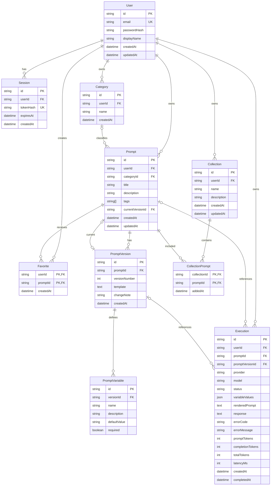

# PromptVault - Database Design

## Implementation Status

The database schema is implemented in `backend/prisma/schema.prisma`.

Verified database setup:

- Prisma schema validation completed.
- Prisma Client 7.10.1 generated successfully.
- Initial PostgreSQL migration created.
- Initial migration applied to the configured Neon PostgreSQL database.
- `npx prisma migrate status` reported: `Database schema is up to date!`

The application has not yet undergone comprehensive live database workflow testing. Backend route tests currently use an injected fake Prisma client.

## 1. Database Technology

| Component | Technology |
|---|---|
| Database | PostgreSQL |
| Database hosting | Neon |
| ORM | Prisma 7 |
| Runtime adapter | `@prisma/adapter-neon` |
| Runtime connection | `DATABASE_URL` |
| Prisma CLI connection | `DIRECT_URL` |

Prisma schema location:

`backend/prisma/schema.prisma`

Migration history:

`backend/prisma/migrations/`

## 2. Entity Relationship Diagram



## 3. Database Models

### User

Stores registered account information.

Important fields:

- `id`: CUID primary key.
- `email`: unique email address, stored in lowercase.
- `passwordHash`: Argon2id password hash.
- `displayName`: optional display name.
- `createdAt` and `updatedAt`: timestamps.

A user can own sessions, categories, prompts, collections, favorites, and execution records.

### Session

Stores authenticated session information.

Important fields:

- `userId`: owning user.
- `tokenHash`: unique SHA-256 hash of the session token.
- `expiresAt`: session expiration.
- `createdAt`: creation timestamp.

The raw session token is not stored in the database.

### Category

Stores user-defined prompt categories.

Important constraints:

- Category names have a maximum length of 50 characters.
- `(userId, name)` is unique.
- Deleting a user cascades to their categories.
- Deleting a category sets associated prompt `categoryId` values to `NULL`.

### Prompt

Stores prompt metadata and its relationship to the current version.

Important fields:

- `userId`: prompt owner.
- `categoryId`: optional category reference.
- `title`: maximum 200 characters.
- `description`: optional, maximum 1,000 characters.
- `tags`: PostgreSQL string array.
- `currentVersionId`: optional unique reference to the current prompt version.

Prompt content is stored in `PromptVersion`, not directly in `Prompt`.

Deleting a user cascades to their prompts. Deleting a prompt cascades to its prompt versions, favorites, and collection memberships.

### PromptVersion

Stores individual versions of a prompt.

Important fields:

- `promptId`: parent prompt.
- `versionNumber`: version sequence number.
- `template`: prompt content stored as PostgreSQL text.
- `changeNote`: optional description, maximum 300 characters.
- `createdAt`: version creation timestamp.

Constraint:

`(promptId, versionNumber)` must be unique.

The application creates new versions when prompt content or variable metadata changes. The design treats existing versions as immutable; this is an application-level rule, not a database-enforced restriction.

Deleting a prompt cascades to its versions.

### PromptVariable

Stores variable metadata associated with a particular prompt version.

Fields include:

- `versionId`
- `name`
- `description`
- `defaultValue`
- `required`

Constraint:

`(versionId, name)` must be unique.

Variable definitions belong to a version so that variable settings can differ between prompt versions.

Deleting a version cascades to its variable definitions.

### Collection

Stores user-created groups of prompts.

Important fields:

- `userId`: collection owner.
- `name`: maximum 100 characters.
- `description`: optional, maximum 500 characters.
- `createdAt` and `updatedAt`.

Constraint:

`(userId, name)` must be unique.

Deleting a user cascades to their collections.

### CollectionPrompt

Join table connecting collections and prompts.

Important fields:

- `collectionId`
- `promptId`
- `addedAt`

The composite primary key `(collectionId, promptId)` prevents duplicate membership.

Both collection and prompt deletion cascade to the corresponding membership records.

**Ownership requirement:** The database foreign keys do not guarantee that the collection and prompt belong to the same user. The API checks ownership of both resources before adding a prompt to a collection.

### Favorite

Join table connecting users and favorite prompts.

The composite primary key `(userId, promptId)` prevents a user from favoriting the same prompt more than once.

Deleting a user or prompt cascades to the corresponding favorite records.

### Execution

Reserved for AI execution records and history.

Important fields:

- `userId`: user who initiated the execution.
- `promptId`: optional reference to the original prompt.
- `promptVersionId`: optional reference to the prompt version.
- `provider`: AI provider enum.
- `model`: model identifier.
- `status`: execution status enum.
- `variableValues`: JSON snapshot of variable values.
- `renderedPrompt`: stored prompt snapshot.
- `response`: optional provider response.
- `errorCode` and `errorMessage`: optional error details.
- `promptTokens`, `completionTokens`, `totalTokens`: optional usage values.
- `latencyMs`: optional execution duration.
- `createdAt` and `completedAt`: timestamps.

The `Execution` model and its enums exist in the schema, but execution API endpoints and provider integration are planned.

Deleting a user cascades to their execution records.

Deleting a prompt or prompt version sets the corresponding optional execution reference to `NULL`. The stored execution snapshot is retained as long as the execution record itself remains.

## 4. Enums

### AIProviderName

| Value | Meaning |
|---|---|
| `GEMINI` | Google Gemini provider |
| `MOCK` | Mock provider for testing or demo functionality |

### ExecutionStatus

| Value | Meaning |
|---|---|
| `PENDING` | Execution initiated |
| `SUCCESS` | Execution completed successfully |
| `ERROR` | Execution failed |
| `TIMEOUT` | Execution timed out |

These enums are defined in the schema. Their complete application workflow is planned.

## 5. Unique Constraints and Indexes

### Unique constraints

| Model | Constraint | Purpose |
|---|---|---|
| User | `email` | Prevent duplicate accounts |
| Session | `tokenHash` | Prevent duplicate session hashes |
| Category | `(userId, name)` | Unique category names per user |
| Prompt | `currentVersionId` | A version can be current for at most one prompt |
| PromptVersion | `(promptId, versionNumber)` | Unique version numbers per prompt |
| PromptVariable | `(versionId, name)` | Unique variable names per version |
| Collection | `(userId, name)` | Unique collection names per user |
| CollectionPrompt | `(collectionId, promptId)` | Prevent duplicate membership |
| Favorite | `(userId, promptId)` | Prevent duplicate favorites |

### Additional indexes

| Model | Index | Purpose |
|---|---|---|
| Session | `userId` | Find sessions belonging to a user |
| Session | `expiresAt` | Support expiration-related queries |
| Prompt | `(userId, updatedAt DESC)` | User prompt library ordered by modification |
| Prompt | `(userId, createdAt DESC)` | User prompt library ordered by creation |
| Prompt | `(userId, categoryId)` | Filter prompts by category |
| Prompt | GIN `(tags)` | Support PostgreSQL array-based tag filtering |
| CollectionPrompt | `promptId` | Find collections containing a prompt |
| Favorite | `promptId` | Find users associated with a prompt |
| Execution | `(userId, createdAt DESC)` | User execution history |
| Execution | `promptId` | Find executions associated with a prompt |
| Execution | `(userId, status)` | Filter executions by status |

Unique constraints also create supporting database indexes where applicable.

## 6. Data Integrity and Deletion Behavior

The schema uses foreign keys and configured referential actions.

| Relationship | Deletion behavior |
|---|---|
| User → Session | Cascade |
| User → Category | Cascade |
| User → Prompt | Cascade |
| User → Collection | Cascade |
| User → Favorite | Cascade |
| User → Execution | Cascade |
| Category → Prompt | SetNull |
| Prompt → PromptVersion | Cascade |
| Prompt → Favorite | Cascade |
| Prompt → CollectionPrompt | Cascade |
| Prompt → Execution | SetNull |
| PromptVersion → PromptVariable | Cascade |
| PromptVersion → Execution | SetNull |
| Collection → CollectionPrompt | Cascade |

Application-level ownership checks remain necessary for resources that are associated through separate user-owned records.

## 7. Search and Filtering

The implemented prompt-list endpoint supports:

- Case-insensitive search on prompt title.
- Case-insensitive search on prompt description.
- Category filtering using `categoryId`.
- Tag filtering using `tag`.
- Pagination using `page` and `limit`.
- Sorting by `updatedAt` in descending order.

Search is scoped to the authenticated user.

**Important:** Searching inside the current prompt template is not currently implemented.

PostgreSQL full-text search or `pg_trgm` indexes may be considered later if search performance requires them.

## 8. Seeding

Automatic default-category creation during registration is not currently documented as an implemented feature.

Default categories and optional starter prompts may be introduced in a future onboarding improvement.

## 9. Migration and Database Verification

The initial migration is stored under:

`backend/prisma/migrations/20261109174418_init/`

The configured Neon database was checked using:

```powershell
cd backend
npx prisma migrate status
```

The reported result was:

```text
1 migration found in prisma/migrations

Database schema is up to date!
```

This confirms that the configured database has the initial migration applied and no pending migrations were reported at the time of the check.

It does not establish that every application workflow has been tested against a live PostgreSQL database.

## 10. Future Database Work

Potential future work includes:

- Live PostgreSQL integration tests for CRUD and ownership behavior.
- Execution history implementation.
- Usage aggregation and quota enforcement.
- Database query performance review with realistic data.
- Additional indexes if query profiling identifies a need.
- Backup and recovery verification before production deployment.

## Related Documentation

- [System Architecture](SYSTEM_ARCHITECTURE.md)
- [API Documentation](API_DOCUMENTATION.md)
- [Security Documentation](SECURITY.md)
- [Project README](../README.md)
