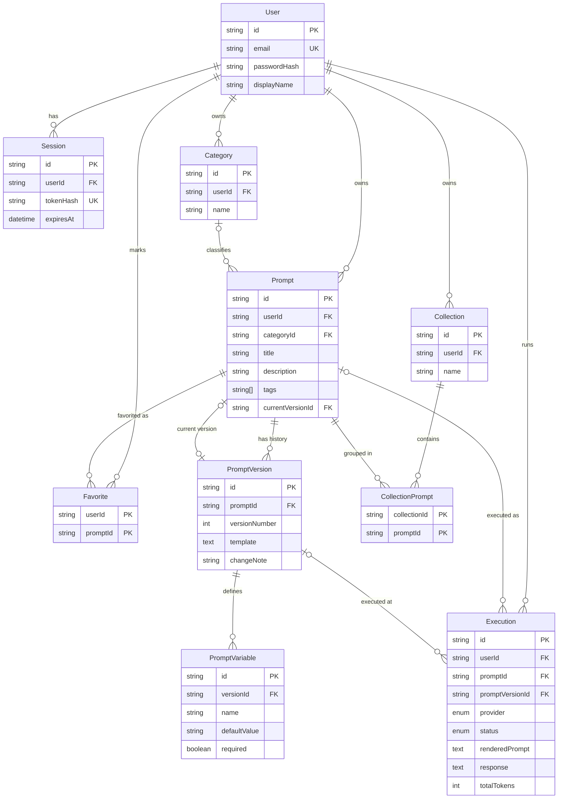

# PromptVault — Database Design

> **Status: DESIGN (Phase 2).** The schema in `backend/prisma/schema.prisma` has not yet been validated or migrated. It will be validated with `prisma validate` and applied to Neon in Phase 3.

## ER diagram

## Design decisions

| Decision | Reason |
|----------|--------|
| Template text lives only in `PromptVersion` | One source of truth; no copy on `Prompt` that can drift. |
| `Prompt.currentVersionId` | Search and list queries join straight to the current template. Set inside a transaction together with version creation. |
| Versions are immutable; restore copies content into a **new** version | History is never overwritten and stays linear. |
| `PromptVariable` per version | A variable's required flag and default can change between versions without rewriting history. Names are derived from the template, not trusted from storage. |
| Tags as `String[]` with a GIN index | Avoids a tags table and join for a simple label list. |
| Favorites as composite-key join table | A prompt is favorited at most once per user (enforced by the key). |
| No `APIUsage` table | Token counts are on `Execution`; daily quota and dashboard stats are aggregated from it, so there is no duplicated data. |
| `Execution` keeps `renderedPrompt` and `variableValues` | History remains meaningful if the prompt is later edited or deleted; also supports retry. |
| `Execution.promptId` / `promptVersionId` are `SetNull` on delete | Deleting a prompt keeps its history; the UI shows "deleted prompt". |
| `Session.tokenHash` | A database leak does not expose usable session tokens. |
| `Prompt.userId` and `Category.userId` use cascade delete | Deleting a user removes all their data. |

## Constraints worth testing

- `User.email` unique (case-insensitive by storing lowercase).
- `(userId, name)` unique for categories and collections.
- `(promptId, versionNumber)` unique; version numbers increment inside a transaction.
- Cross-user links (a collection containing another user's prompt) are impossible through the API because services check ownership; the database alone does not enforce this, so it needs an explicit integration test.

## Indexes

| Table | Index | Serves |
|-------|-------|--------|
| Prompt | `(userId, updatedAt desc)` | Library sorted by modified date, recent activity |
| Prompt | `(userId, createdAt desc)` | Library sorted by created date |
| Prompt | `(userId, categoryId)` | Category filter, category distribution |
| Prompt | GIN `(tags)` | Tag filter |
| Execution | `(userId, createdAt desc)` | History list, daily quota count |
| Execution | `(promptId)` | Per-prompt history, most-used prompts |
| Execution | `(userId, status)` | Success/error stats |
| Session | `(userId)`, `(expiresAt)` | Revoke all sessions, expired-session cleanup |

## Seeding

On registration, each user gets default categories: Coding, Writing, Marketing, General (same as the legacy app). Starter prompts based on the three legacy examples may be offered as an optional "load examples" action, not forced.

## Search

Initial implementation: case-insensitive `contains` on title, description and current template, scoped by `userId`. If performance becomes an issue, add `pg_trgm` indexes later. Not needed at portfolio scale.
