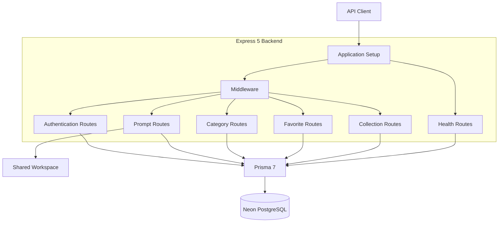
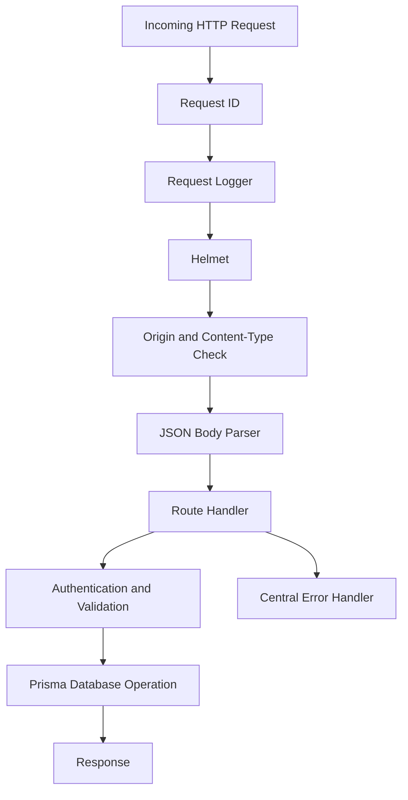
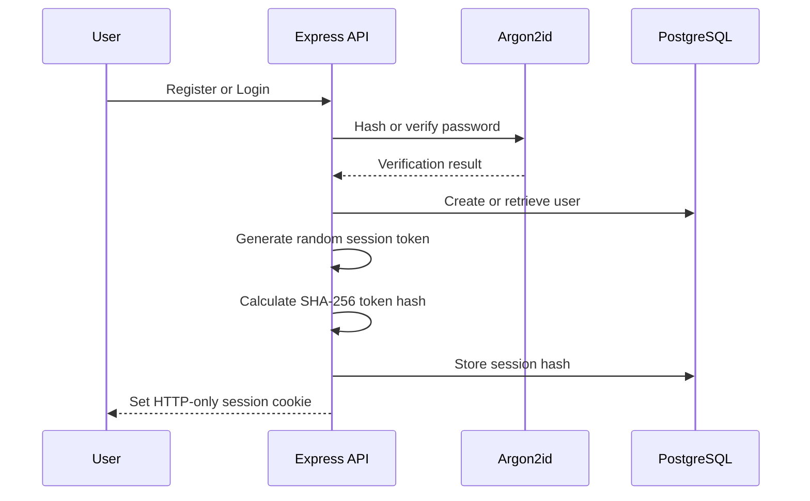
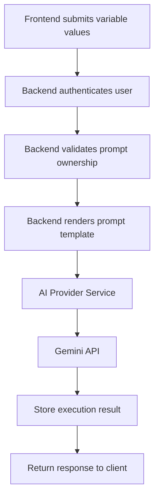
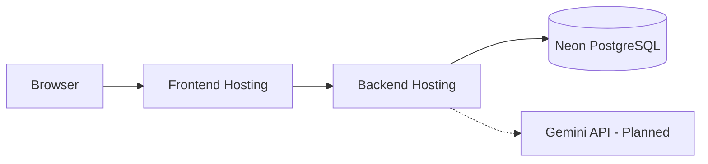

# PromptVault - System Architecture

## Implementation Status

PromptVault is an actively developed prompt management platform.

The current implementation includes:

- TypeScript monorepo with npm workspaces.
- Express 5 backend API.
- Prisma 7 database integration.
- Neon PostgreSQL database.
- User registration, login, logout, and session authentication.
- Prompt CRUD and version management.
- Prompt variable detection and validation.
- Categories, favorites, and collections.
- Automated shared-package and backend tests.

The React frontend, AI provider integration, execution history, and production deployment are planned.

## 1. Architecture Decisions

| Area | Decision |
|---|---|
| Repository structure | npm workspaces: backend, frontend, shared |
| Backend | Node.js, TypeScript, Express 5 |
| Database | PostgreSQL hosted on Neon |
| ORM | Prisma 7 |
| Database adapter | Prisma Neon adapter |
| Authentication | Server-side sessions with opaque tokens |
| Password hashing | Argon2id using `@node-rs/argon2` |
| Session storage | SHA-256 token hashes in PostgreSQL |
| Validation | Zod |
| Logging | Pino |
| Security middleware | Helmet and custom Origin checks |
| Prompt variables | `{{name}}` syntax |
| Tags | PostgreSQL text array |
| AI provider | Gemini integration planned |

Additional architectural decisions:

- A dedicated `Session` model supports server-side session validation and logout.
- A shared workspace contains reusable application types and validation logic.
- `PromptVersion` stores versioned prompt content.
- `Prompt.currentVersionId` identifies the current prompt version.
- `PromptVariable` records variable metadata associated with a prompt version.
- `Favorite` and `CollectionPrompt` use composite identifiers to prevent duplicate relationships.

## 2. High-Level Architecture

### Current implementation



The backend currently exposes a REST API. A separate frontend application has not yet been implemented.

### Implemented API route groups

| Route group | Base path | Responsibility |
|---|---|---|
| Health | `/api/health` | Liveness and database readiness |
| Authentication | `/api/auth` | Registration, login, current user, logout |
| Prompts | `/api/prompts` | Prompt CRUD, search, and version management |
| Categories | `/api/categories` | Category management |
| Favorites | `/api/favorites` | Favorite management |
| Collections | `/api/collections` | Collection and membership management |

## 3. Backend Architecture

The backend is organized around Express routes, middleware, configuration, authentication utilities, and Prisma database access.

### Main components

| Component | Responsibility |
|---|---|
| `src/app.ts` | Creates the Express application and mounts middleware and routes |
| `src/server.ts` | Starts the HTTP server and handles graceful shutdown |
| `src/routes/` | Implements API endpoint behavior |
| `src/middleware/` | Authentication, Origin checks, request IDs, logging, errors, and not-found handling |
| `src/auth/` | Session and password authentication functionality |
| `src/config/` | Environment validation, database initialization, and logger configuration |
| `prisma/` | Database schema and migration history |
| `test/` | Backend automated tests |

The current backend implements business logic within its route modules and supporting utilities. Separate controller, service, and provider layers are possible future refactoring improvements; they are not currently part of the implemented architecture.

### Request lifecycle



The request body parser has a 100 KB limit.

Protected routes authenticate the user before performing user-scoped operations.

## 4. Authentication Architecture

Authentication uses server-side sessions.

### Registration and login flow



### Session properties

- Session tokens use cryptographically secure random bytes.
- Tokens are encoded using Base64URL.
- Only the SHA-256 hash is stored in the database.
- Cookie name: `pv_session`.
- HTTP-only cookie.
- `SameSite=Lax`.
- Secure attribute enabled in production.
- Session duration: seven days.
- Logout deletes the corresponding session record.

The authentication middleware validates sessions before granting access to protected endpoints.

## 5. Prompt Management and Versioning

Prompt management is a central feature of PromptVault.

### Prompt creation

When a user creates a prompt:

1. The API validates the request.
2. The backend checks category ownership when a category is supplied.
3. Prompt variables are detected and validated.
4. A prompt and its first version are created in a database transaction.
5. The created prompt is returned to the client.

### Prompt updates

- Metadata-only changes update the prompt without creating a new version.
- Template or variable metadata changes create a new prompt version.
- Matching existing variable metadata is preserved when applicable.
- The current version reference is updated.

Dedicated APIs for listing individual versions, comparing versions, and restoring old versions are planned.

## 6. Shared Workspace and Variable Engine

The `shared` workspace contains reusable logic and types used by the application.

The prompt variable syntax is:

`{{variable_name}}`

Implemented functionality includes:

- Detecting variable placeholders.
- Identifying unique variable names.
- Validating variable definitions.
- Detecting malformed placeholders.
- Validating required variable values.
- Supporting optional variables and default values.
- Rendering templates using supplied values.

Variable identifiers follow this pattern:

`^[A-Za-z_][A-Za-z0-9_]{0,49}$`

Configured limits include:

| Item | Limit |
|---|---:|
| Template | 50,000 characters |
| Variable value | 10,000 characters |
| Variables per template | 50 |

Rendering is designed as a single-pass replacement operation. Values are inserted as text and are not recursively interpreted as additional placeholders.

AI prompt execution and provider-side rendering are not yet implemented.

## 7. Database Architecture

PromptVault uses PostgreSQL with Prisma 7 and the Neon serverless adapter.

### Main database models

| Model | Purpose |
|---|---|
| User | Stores user account information |
| Session | Stores hashed session tokens |
| Category | User-defined prompt categories |
| Prompt | Stores prompt metadata and current version reference |
| PromptVersion | Stores versioned prompt content |
| PromptVariable | Stores variable definitions for a prompt version |
| Favorite | Associates users with favorite prompts |
| Collection | Stores user-defined prompt collections |
| CollectionPrompt | Associates prompts with collections |
| Execution | Reserved for future AI execution records |

### Important database constraints

- User email addresses are unique.
- Category names are unique per user.
- Collection names are unique per user.
- Prompt version numbers are unique per prompt.
- Favorite records are unique per user and prompt.
- Collection membership is unique per collection and prompt.
- User-owned records use relational ownership and cascade behavior where configured.

The service/API layer must verify ownership of both sides of collection membership because the database relationship alone does not enforce same-user ownership.

### Migration status

- Prisma schema validation completed.
- Prisma Client generation completed.
- Initial migration file created.
- Initial migration applied to the configured Neon PostgreSQL database.
- `npx prisma migrate status` reported that the database schema is up to date.

See [Database Design](DATABASE_DESIGN.md) for the complete schema and relationship documentation.

## 8. Frontend Architecture

**Status: Planned**

The frontend directory currently exists as a workspace scaffold. It does not yet contain the implemented React application.

The intended frontend stack is:

- React
- TypeScript
- Vite
- Tailwind CSS

Planned application areas include:

| Route | Planned responsibility |
|---|---|
| `/login` | User login |
| `/register` | User registration |
| `/` | Dashboard |
| `/prompts` | Prompt library |
| `/prompts/:id` | Prompt editor and workspace |
| `/collections` | Collection management |
| `/settings` | Account and application settings |

Additional frontend features may include prompt variable inputs, version history, execution output, and responsive layouts.

These routes and components are design targets, not implemented application functionality.

## 9. AI Execution Architecture

**Status: Planned**

Gemini is the intended AI provider.

The planned execution architecture is:



Planned security requirements:

- Provider credentials remain on the backend.
- The frontend must never call the provider using a server API key.
- The server validates and renders prompt templates.
- Provider failures and timeouts are handled safely.
- Execution history is associated with the authenticated user.
- Appropriate per-user usage limits are enforced.

The current API does not expose prompt execution endpoints. The `Execution` database model is reserved for this future functionality.

## 10. Security Architecture

Implemented controls include:

- Argon2id password hashing.
- Hashed session token storage.
- HTTP-only session cookies.
- Authentication middleware.
- User-scoped resource access.
- Zod request validation.
- Helmet security headers.
- Origin and JSON content-type checks.
- Authentication rate limiting.
- Centralized error handling.
- Request IDs.
- A 100 KB JSON body limit.

Production deployment security, frontend security, AI execution limits, and other planned protections require further work.

See [Security Documentation](SECURITY.md).

## 11. Environment and Runtime Configuration

Backend environment configuration is validated using Zod.

The example file is:

`backend/.env.example`

| Variable | Purpose |
|---|---|
| `NODE_ENV` | Application environment |
| `PORT` | HTTP server port |
| `FRONTEND_ORIGIN` | Allowed frontend Origin |
| `LOG_LEVEL` | Pino logging level |
| `DATABASE_URL` | Runtime PostgreSQL connection |
| `DIRECT_URL` | Direct PostgreSQL connection for Prisma CLI operations |

The backend uses `DATABASE_URL` through the Prisma Neon adapter.

Prisma CLI database operations use `DIRECT_URL` through `backend/prisma.config.ts`.

Actual credentials must be supplied locally or through the deployment environment. They must never be committed to the repository.

## 12. Deployment Architecture

**Status: Not yet deployed**

The current application has been developed locally with a Neon PostgreSQL database.

The following is a possible future deployment topology, not an existing production deployment:



Deployment provider selection, frontend/backend domain configuration, proxy settings, production cookie behavior, and deployment monitoring still require verification.

## 13. Repository Structure

```text
Prompt-Vault/
├── backend/
│   ├── prisma/
│   │   ├── migrations/
│   │   └── schema.prisma
│   ├── src/
│   │   ├── auth/
│   │   ├── config/
│   │   ├── middleware/
│   │   └── routes/
│   ├── test/
│   ├── .env.example
│   └── package.json
├── frontend/
│   └── package.json
├── shared/
│   ├── src/
│   ├── test/
│   └── package.json
├── docs/
│   ├── API_DOCUMENTATION.md
│   ├── DATABASE_DESIGN.md
│   ├── SECURITY.md
│   └── SYSTEM_ARCHITECTURE.md
├── package.json
├── package-lock.json
├── tsconfig.base.json
├── index.html
└── README.md
```

The frontend is currently a scaffold. The existing root `index.html` has not been replaced by a completed React application.

## 14. Development and Verification

The following commands are available from the repository root:

| Command | Purpose |
|---|---|
| `npm install` | Install workspace dependencies |
| `npm run dev:backend` | Start the backend development server |
| `npm test` | Run shared and backend automated tests |
| `npm run typecheck` | Type-check shared and backend packages |
| `npm run build` | Build shared and backend packages |

Latest recorded automated test results:

- Shared tests: 8 passed.
- Backend tests: 30 passed.
- Total: 38 passed.

The backend route tests use an injected fake Prisma client. Live database integration testing is still required.

## 15. Roadmap

| Stage | Deliverable | Status |
|---|---|---|
| Foundation | Monorepo, TypeScript, Prisma, Neon, environment validation, health endpoint | Implemented |
| Authentication | Registration, login, logout, session validation | Implemented |
| Prompt management | CRUD, variable validation, prompt version creation | Implemented |
| Organization | Categories, favorites, collections, membership | Implemented; verification completed locally |
| Documentation | README, API, security, architecture documentation | In progress |
| Frontend | React application and responsive UI | Planned |
| AI execution | Gemini integration and execution history | Planned |
| Quality assurance | Live database integration tests, expanded test coverage, CI | Planned |
| Deployment | Production hosting, configuration, and monitoring | Planned |

## 16. Project Direction

The development approach is to complete and verify backend functionality first, establish a clear public repository, and then build the frontend and AI execution features.

All documentation should describe the current implementation accurately and distinguish completed functionality from future plans.
