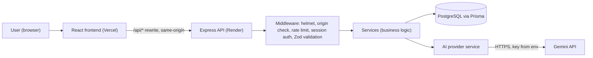
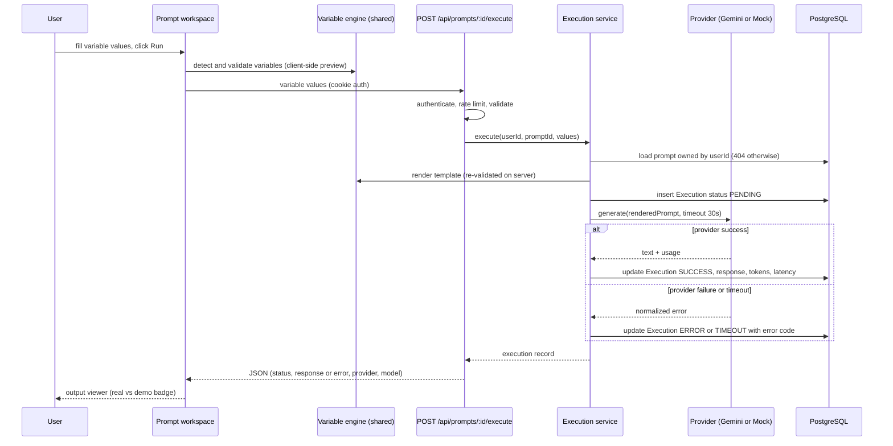
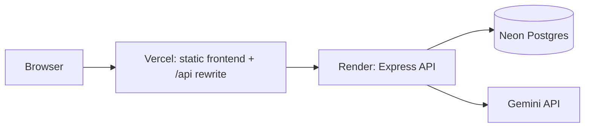

# PromptVault — System Architecture

> **Status: DESIGN (Phase 2).** Nothing described here is implemented yet.
> Each section is updated to reflect the real code as each phase ships.

## 1. Approved decisions

| # | Decision |
|---|----------|
| 1 | Final deployment: Vercel (frontend) + Render/Railway (backend) + managed Postgres. Legacy GitHub Pages demo stays online until the new app is deployed and verified. |
| 2 | Auth: opaque session token in an **httpOnly cookie**; frontend proxies `/api` to the backend so the cookie is same-origin. |
| 3 | Password hashing: **Argon2id** via `@node-rs/argon2` (prebuilt binaries, no Windows build tools). |
| 4 | Development database: free cloud Postgres (Neon). Tests use a separate database/branch. |
| 5 | AI provider: Gemini; model name comes from `GEMINI_MODEL` env var. |
| 6 | Schema: no `APIUsage` table; tags are a `String[]` column; `PromptVariable` belongs to a `PromptVersion`. |
| 7 | Variable syntax is `{{name}}`. Legacy `{name}` is converted on legacy import only. |
| 8 | Build order: vertical slice first (auth, CRUD, variables, real Gemini, deploy), then versions, collections, dashboard, import/export. |

Additions made while designing (small, within the approved direction):

- **`Session` table.** Needed for real logout and revocation with cookie auth. Only a SHA-256 hash of the token is stored.
- **`shared/` workspace package.** Holds the variable engine and Zod schemas so frontend and backend use identical logic (no duplicated code).
- **`Prompt.currentVersionId`.** Makes "search inside the current template" a simple join and avoids copying template text onto `Prompt`.

## 2. High-level architecture



### AI execution flow



Rules that follow from this flow:

- The server **never** reports `SUCCESS` unless the provider returned text.
- The browser never sees the API key; the browser never calls Gemini directly.
- Server re-renders the template; it does not trust a client-rendered prompt.
- Demo mode (`AI_DEMO_MODE=true`) is the only path that uses the Mock provider. Those rows are stored with `provider = MOCK` and shown with a visible "Demo" badge. If no key is set and demo mode is off, execute returns `503 AI_NOT_CONFIGURED`.

## 3. Backend architecture

```
routes/        URL -> controller wiring only
controllers/   parse request, call service, shape response (no business logic)
services/      business rules, authorization scoping, transactions
middleware/    auth, origin check, rate limit, validate(zod), error handler, request id
validators/    thin wrappers around schemas from shared/
providers/     AIProvider interface, GeminiProvider, MockProvider, error normalization
config/        typed env loading (fails fast if invalid), constants
utils/         logger (pino, redaction), hashing, tokens, pagination
```

Provider interface:

```ts
interface AIProvider {
  readonly name: 'GEMINI' | 'MOCK';
  generate(req: {
    prompt: string; model: string; signal: AbortSignal;
    temperature?: number; maxOutputTokens?: number;
  }): Promise<{ text: string; model: string;
    usage?: { promptTokens?: number; completionTokens?: number; totalTokens?: number } }>;
}
```

Normalized provider errors: `PROVIDER_AUTH`, `PROVIDER_RATE_LIMIT`, `PROVIDER_TIMEOUT`, `PROVIDER_BLOCKED` (safety), `PROVIDER_BAD_REQUEST`, `PROVIDER_UNAVAILABLE`. Raw provider messages are logged server-side, not returned to users.

One automatic retry is allowed only for network errors and 5xx. No automatic retry for 4xx or timeouts. User-triggered retry is a separate endpoint and creates a new Execution row.

### Authorization rule (IDOR protection)

Every service method takes `userId` and every Prisma query includes it in `where` (e.g. `findFirst({ where: { id, userId } })`). Resources owned by someone else return **404**, not 403, so existence is not leaked. Join tables (collection↔prompt) verify both sides belong to the same user in the service, because the database cannot express that constraint.

## 4. Frontend architecture

Stack: React, TypeScript, Vite, Tailwind, React Router, TanStack Query, React Hook Form + Zod.

Pages and routes:

| Route | Page |
|-------|------|
| `/login`, `/register` | Authentication |
| `/` | Dashboard |
| `/prompts` | Prompt library (search, filter, sort, pagination) |
| `/prompts/:id` | **Workspace**: editor + variable inputs + output (the legacy three-pane layout) |
| `/prompts/:id/versions` | Version history and compare |
| `/history`, `/history/:id` | Execution history |
| `/collections`, `/collections/:id` | Collections |
| `/import-export` | Import / export |
| `/settings` | Theme, account |

Component groups: `AppLayout` (sidebar, topbar, theme toggle), `PromptList`, `PromptEditor`, `VariableInputs` (generated from `detectVariables`), `ExecutionPanel`, `OutputViewer`, `VersionDiff`, `ConfirmDialog`, `Toast`, `EmptyState`, `ProtectedRoute`.

State: server state in TanStack Query; auth user in `AuthContext`; theme in `ThemeContext` (persisted in `localStorage`, which is the one acceptable use of it).

Rendering rules: React text nodes only; no `dangerouslySetInnerHTML`. AI output is shown as plain preformatted text first; if Markdown rendering is added it uses a renderer that does not allow raw HTML.

## 5. Variable engine (in `shared/`)

- Placeholder pattern: `{{name}}`, whitespace allowed inside braces. Valid name: `^[A-Za-z_][A-Za-z0-9_]{0,49}$`.
- `detectVariables(template)` returns unique names in first-appearance order, plus `invalid` for malformed placeholders such as `{{1a}}` or `{{a-b}}` (reported to the user, not silently ignored).
- `render(template, values, defs)` is a **single-pass** replacement, so a value containing `{{other}}` is inserted literally and never re-expanded.
- Required variables with missing or whitespace-only values fail with a list of names. Optional empty variables use the default or empty string.
- Literal braces: write `\{{` to output `{{`.
- Output is plain text. Nothing is evaluated, and nothing is inserted as HTML.
- Limits: template 50,000 chars; value 10,000 chars; 50 variables per template.
- `convertLegacy(template)` turns `{name}` into `{{name}}` (used only for legacy prompt import).

## 6. Security design (summary; detail in SECURITY.md)

Argon2id; hashed opaque session tokens; httpOnly + Secure + SameSite=Lax cookie; Origin check on state-changing requests; Zod on every body, query and param; helmet; strict CORS; rate limits; per-user data scoping; safe import (strict schema, no client-supplied IDs, size caps); error handler hides stack traces; secrets only from env; `.env` git-ignored.

## 7. Deployment topology



Local development: Vite dev server proxies `/api` to `localhost:4000`; database is Neon (dev); `docker-compose.yml` provides containers for the backend/frontend and an optional local Postgres for offline work and CI-like runs.

Known deployment unknowns (to verify when deploying, not assume): free-tier cold starts on the backend host; correct `trust proxy` hop count behind Vercel + Render for rate-limit IPs.

## 8. Repository layout

```
Prompt-Vault/
├─ index.html            (legacy app, untouched until the new app is verified)
├─ frontend/             src/{components,pages,layouts,hooks,services,contexts,types,utils}
├─ backend/              src/{config,routes,controllers,services,middleware,validators,providers,utils}
│                        prisma/schema.prisma, tests/
├─ shared/               variable engine, Zod schemas, types
├─ e2e/                  Playwright tests
├─ docs/
├─ docker-compose.yml
├─ .env.example (root, backend, frontend)
├─ .gitignore
└─ README.md
```

The legacy `index.html` moves to `legacy/` only after the new app is deployed and verified.

## 9. Roadmap and exit criteria

| Phase | Deliverable | Verified by |
|-------|-------------|-------------|
| 3 | Monorepo, TS, Prisma + first migration on Neon, env validation, error handling, health endpoint | App starts; `/api/health` returns OK; migration applied |
| 4 | Auth, prompt CRUD, variables, categories, favorites, search/pagination | Backend integration tests; manual run |
| 5 | Gemini provider, execution, history, demo mode | Mocked-provider tests; one real call with your key |
| 6 | Versioning and compare, collections, import/export, dashboard | Integration tests |
| 7 | Responsive layout, accessibility, themes, empty/loading/error states | Manual checks on desktop and mobile widths |
| 8 | Unit, integration and Playwright tests, lint, typecheck, builds, CI | Green test run |
| 9 | README, docs, screenshots of the running app | Docs match code |
| 10 | Clean-clone verification and final report | Fresh setup following README |

After Phase 5 the project already supports an honest resume line about a full-stack app with real AI execution. Wait until each feature is working before putting it on the resume.
